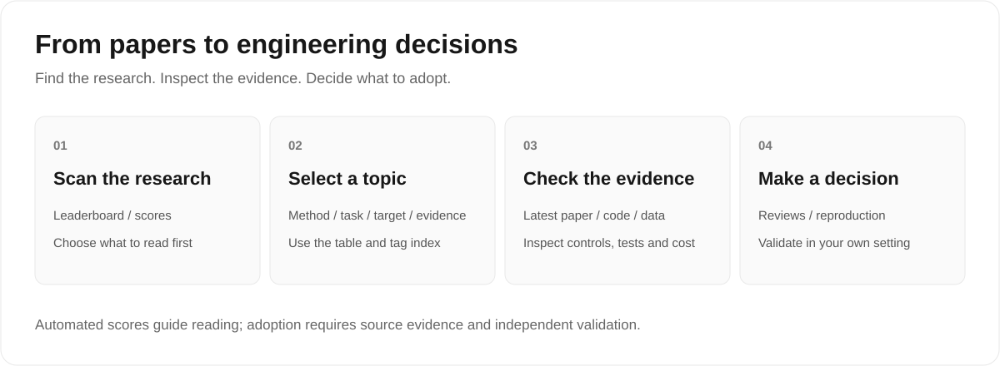

# AI for Security Paper

**Research on AI-assisted security code auditing, with evidence and engineering context.**

[简体中文](README.md) · English


For researchers and engineers building **AI security code audit agents**. This collection covers vulnerability detection, localization, repair, fuzzing and secure code generation, with per-paper judgments, automated evidence scores, topic indexes and selected reviews.

**676 papers · 9 topics · 4 tag axes · Chinese & English**

The corpus cutoff is **2026-11-09**; documentation and catalog consistency were updated on **2026-11-14**. This maintenance update adds no papers and changes no existing scores. The search window is 2025-08-04 through 2026-11-09, with a historical reference retained in the review document.

## Start reading

| Your goal | Reading entry |
|---|---|
| Scan papers and grades | [Leaderboard](en/value-ranking-leaderboard.md) |
| Browse dates, topics, tags and scoring reasons | [Master table](en/per-paper-value-master-table.md) |
| Filter by method, task, target and evidence | [Tag index](en/tag-taxonomy-and-index.md) |
| Understand experimental credibility and engineering tradeoffs | [Rankings & reviews](en/comprehensive-ranking-and-detailed-reviews.md) |



The leaderboard, master table and tag index cover the same **676 papers**. The original detailed ranking covers **328 in-window papers + 1 historical reference**, with conclusions dated 2026-08-20 and supplemental highlights through 2026-10-28. The published document contains the first 6 detailed reviews and supplemental highlights; **50 referenced batch-review attachments are not published**. Full detailed reviews are therefore not available for the entire corpus. See [publication boundaries](docs/methodology.en.md).

## Topics

<!-- topics:start -->
| Topic | Papers |
|---|---:|
| Vulnerability Detection, Localization, and Verification | 189 |
| Fuzzing, Dynamic Analysis, and Exploit Verification | 106 |
| Security of AI-Generated Code | 89 |
| Smart Contract Auditing | 73 |
| Secure Code Review and Static Analysis | 69 |
| Binary, Firmware, and Reverse Engineering | 48 |
| Vulnerability Repair and Security Patching | 45 |
| Software Supply Chain, Malicious Code, and Software Packages | 35 |
| Benchmarks, Datasets, and Evaluation Methods | 22 |
| **Total** | **676** |
<!-- topics:end -->

Counts are generated after checking both language versions. Each paper has one primary topic; tags allow multiple labels and their counts must not be summed as a paper total.

## Interpreting the scores

The automated evidence score has five dimensions: **Innovation 20 / Rigor 30 / Grounding 20 / Reproducibility 15 / Engineering 15**, totaling 100. Grades are A ≥ 75, B 60–74, C 45–59 and D < 45. Current distribution: **A 7 / B 226 / C 352 / D 91**.

These inherited automated assessments help prioritize reading. They **do not constitute peer review, independent reproduction or a definitive judgment of research quality**. The detailed review document uses a separate 10-point scale that is not directly comparable.

“Artifacts not identified” or “evaluation section not reliably identified” means extraction did not find evidence; it does not establish that the authors failed to release artifacts or run experiments. Before adopting a method, check the latest paper version, code, data splits, negative controls, executable validation and costs. See [methodology and limitations](docs/methodology.en.md) / [中文说明](docs/methodology.md).

## Download and reuse

- [Full JSON catalog](data/papers.json): bilingual topics, tags, confidence, judgments and dimension scores.
- [Full CSV catalog](data/papers.csv): UTF-8, suitable for spreadsheets and analysis tools.
- [Contribution and maintenance guide](CONTRIBUTING.md): paper additions, corrections and offline validation.
- [Changelog](CHANGELOG.md): corpus additions and documentation maintenance are recorded separately.

Rebuild and check IDs, bilingual consistency, rankings, scores, generated files and local links with Python 3.10+, without third-party dependencies:

```sh
python scripts/build_catalog.py
python scripts/build_catalog.py --check
```

This repository reviews public academic literature. Papers, code and datasets remain subject to their respective owners' rights and licenses; consult each original artifact's license before reuse. Corrections with primary sources are welcome via [Issues](https://github.com/8eeth0ven/AI-for-Security-Paper/issues) or pull requests.
