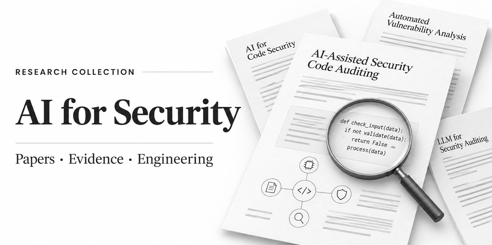
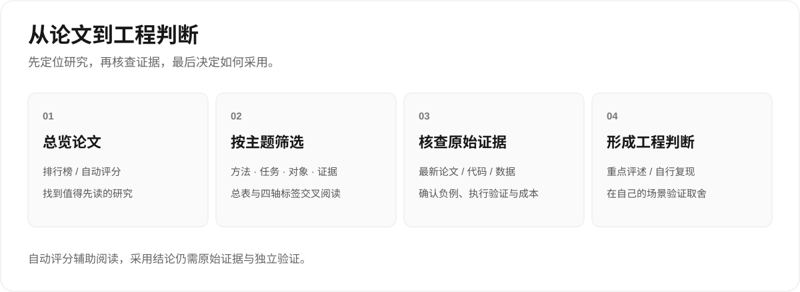

# AI for Security Paper

**AI 安全代码审计论文：从研究结论走向工程判断。**

简体中文 · [English](README.en.md)



面向构建 **AI 安全代码审计 Agent** 的研究者与工程师，整理漏洞检测、定位、修复、模糊测试与安全代码生成研究，提供逐篇判断、自动证据评分、专题索引和重点评述。

**676 篇论文 · 9 个主题 · 4 轴标签 · 中英文对照**

文献收录截至 **2026-11-09**；文档与目录校准于 **2026-11-14**。本轮未新增论文、未重评既有分数。检索窗口为 2025-08-04 至 2026-11-09，深度评述另保留历史对照。

## 从这里开始

| 你想做什么 | 阅读入口 |
|---|---|
| 快速了解论文与分级 | [含金量排行榜](zh/含金量排行榜.md) |
| 按主题查看日期、标签与加减分理由 | [逐篇总表](zh/逐篇论文含金量总表.md) |
| 按方法、任务、对象与证据筛选 | [标签索引](zh/标签体系与索引.md) |
| 理解实验可信度与工程取舍 | [综合排名与重点评述](zh/深度综合排名与逐篇审稿.md) |



排行榜、总表与标签索引覆盖同一批 **676 篇**论文。深度评述的原始排名范围为 **328 篇窗口内重点论文 + 1 篇历史对照**，结论日期为 2026-08-20，另含至 2026-10-28 的增补亮点。正文当前包含首批 6 篇详细评述与增补速览；原文提及的 **50 份分批审稿附件尚未公开**，不应理解为全库均有可读的深度全文。见[公开材料边界](docs/methodology.md)。

## 覆盖哪些方向

<!-- topics:start -->
| 主题 | 篇数 |
|---|---:|
| 漏洞检测、定位与验证 | 189 |
| 模糊测试、动态分析与利用验证 | 106 |
| AI 生成代码安全 | 89 |
| 智能合约审计 | 73 |
| 安全代码评审与静态分析 | 69 |
| 二进制、固件与逆向分析 | 48 |
| 漏洞修复与安全补丁 | 45 |
| 软件供应链、恶意代码与软件包 | 35 |
| 基准、数据集与评测方法 | 22 |
| **合计** | **676** |
<!-- topics:end -->

数量由双语正文校验后生成，每篇只计一个主主题；四轴标签可多选，标签数量不可相加当作论文总数。

## 如何理解评分

自动证据评分采用 **创新 20 / 严谨 30 / 真实证据 20 / 复现 15 / 工程 15**，总分 100。分级为 A ≥ 75、B 60–74、C 45–59、D < 45；当前 **A 7 / B 226 / C 352 / D 91**。

评分用于安排阅读顺序，是既有材料中的自动评估，**不等于同行评审、独立复现或论文质量的最终裁决**。深度评述使用另一个 10 分制，不能与自动榜单直接比较。

“未识别到工件”“未可靠识别实验章节”表示抽取未命中，不能据此断言作者没有公开或没有开展。采用研究方案前，请核对最新论文版本、代码、数据切分、负例、执行验证与成本。见[方法与已知局限](docs/methodology.md) / [English](docs/methodology.en.md)。

## 下载与复用

- [JSON 完整目录](data/papers.json)：双语主题、标签、置信度、逐篇判断与五维分数。
- [CSV 完整目录](data/papers.csv)：UTF-8，可导入 Excel、分析工具或个人文献库。
- [贡献与维护指南](CONTRIBUTING.md)：新增论文、纠错、重建目录和离线检查。
- [更新日志](CHANGELOG.md)：区分文献增补与文档维护。

无需安装依赖，Python 3.10+ 即可重建目录并检查双语 ID、排名、分数、生成文件和本地链接：

```sh
python scripts/build_catalog.py
python scripts/build_catalog.py --check
```

这是公开学术文献的整理与评述。论文、代码和数据的权利及许可归各自权利人；使用工件时请查阅原项目许可。欢迎附原始来源提交 [Issue](https://github.com/8eeth0ven/AI-for-Security-Paper/issues) 或 PR 纠错。
