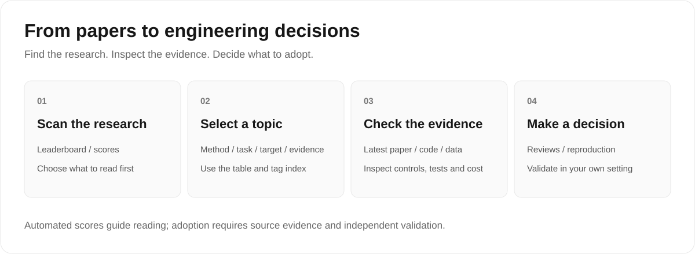

# English reading guide

[Project home](../README.en.md) · [简体中文](../zh/README.md)

English reviews and indexes for AI-assisted security code auditing. **676 papers**, corpus cutoff **2026-11-09**; documentation maintained on **2026-11-14**.

## Four documents, four uses

| Document | Purpose and coverage |
|---|---|
| [Value ranking leaderboard](value-ranking-leaderboard.md) | 676 papers; five-dimension automated evidence scores, graded A/B/C/D. |
| [Per-paper master table](per-paper-value-master-table.md) | 676 papers; topics, dates, tags, confidence and scoring reasons. |
| [Tag taxonomy and index](tag-taxonomy-and-index.md) | 676 papers; browse method, task, target and evidence axes. |
| [Rankings and selected reviews](comprehensive-ranking-and-detailed-reviews.md) | Original detailed ranking: 328 in-window papers + 1 historical reference; conclusions dated 2026-08-20, highlights through 2026-10-28. The published file contains the first 6 detailed reviews and highlights; 50 batch attachments are not published. |

## Topic distribution

<!-- topics:start -->
| Topic | Papers |
|---|---:|
| Vulnerability Detection, Localization, and Verification | 189 |
| Fuzzing, Dynamic Analysis, and Exploit Verification | 106 |
| Security of AI-Generated Code | 89 |
| Smart Contract Auditing | 73 |
| Secure Code Review and Static Analysis | 69 |
| Binary, Firmware, and Reverse Engineering | 48 |
| Vulnerability Repair and Security Patching | 45 |
| Software Supply Chain, Malicious Code, and Software Packages | 35 |
| Benchmarks, Datasets, and Evaluation Methods | 22 |
| **Total** | **676** |
<!-- topics:end -->

## Scores and publication boundaries

Automated scores total 100: Innovation 20, Rigor 30, Grounding 20, Reproducibility 15 and Engineering 15. A ≥ 75, B 60–74, C 45–59, D < 45. Current grades: A 7 / B 226 / C 352 / D 91. Detailed reviews use a separate 10-point scale.

Scores prioritize reading and do not constitute peer review or independent reproduction. “Not identified” denotes an extraction miss, not proof that work or artifacts are absent. Full detailed reviews are not published for the entire corpus. See [methodology and limitations](../docs/methodology.en.md).

[JSON catalog](../data/papers.json) · [CSV catalog](../data/papers.csv) · [Contribution guide](../CONTRIBUTING.md) · [Changelog](../CHANGELOG.md)
