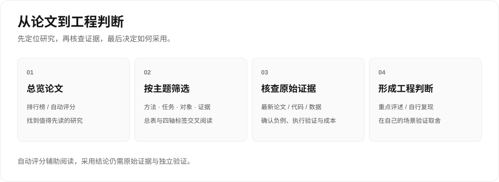

# 中文阅读目录

[项目首页](../README.md) · [English](../en/README.md)

AI 安全代码审计论文的中文评述与索引。当前目录 **676 篇**，文献截至 **2026-11-09**；文档维护日期 **2026-11-14**。

## 四份文档，各有用途

| 文档 | 用途与覆盖 |
|---|---|
| [含金量排行榜](含金量排行榜.md) | 676 篇；按五维自动证据评分排列，A/B/C/D 分级。 |
| [逐篇论文含金量总表](逐篇论文含金量总表.md) | 676 篇；按主题浏览日期、标签、置信度与加减分理由。 |
| [标签体系与索引](标签体系与索引.md) | 676 篇；按方法、任务、对象、证据四轴反查。 |
| [综合排名与重点评述](深度综合排名与逐篇审稿.md) | 原始排名范围 328 篇重点论文 + 1 篇历史对照；结论日期 2026-08-20，增补亮点至 2026-10-28。当前公开首批 6 篇详细评述及速览，50 份分批附件尚未公开。 |

## 主题分布

<!-- topics:start -->
| 主题 | 篇数 |
|---|---:|
| 漏洞检测、定位与验证 | 189 |
| 模糊测试、动态分析与利用验证 | 106 |
| AI 生成代码安全 | 89 |
| 智能合约审计 | 73 |
| 安全代码评审与静态分析 | 69 |
| 二进制、固件与逆向分析 | 48 |
| 漏洞修复与安全补丁 | 45 |
| 软件供应链、恶意代码与软件包 | 35 |
| 基准、数据集与评测方法 | 22 |
| **合计** | **676** |
<!-- topics:end -->

## 评分与材料边界

自动评分总分 100：创新 20、严谨 30、真实证据 20、复现 15、工程 15。A ≥ 75，B 60–74，C 45–59，D < 45。当前 A 7 / B 226 / C 352 / D 91。深度评述另用 10 分制。

评分用于阅读排序，不等于同行评审或独立复现；“未识别”表示抽取未命中，不代表作者没有做。全库不能宣称均有公开深度审稿。详见[方法与局限](../docs/methodology.md)。

[JSON 目录](../data/papers.json) · [CSV 目录](../data/papers.csv) · [贡献指南](../CONTRIBUTING.md) · [更新日志](../CHANGELOG.md)
